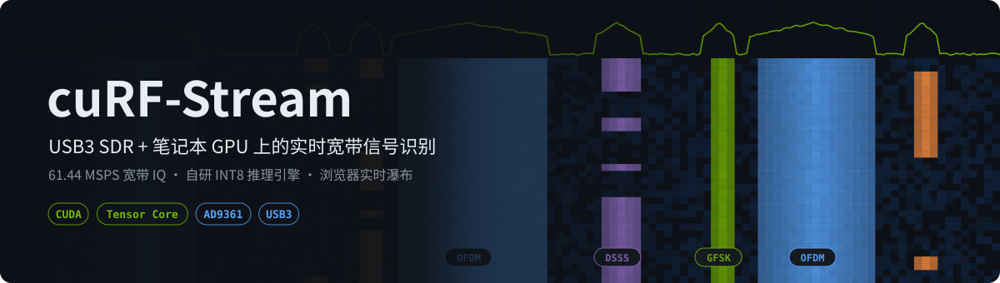
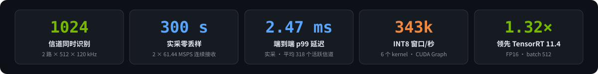
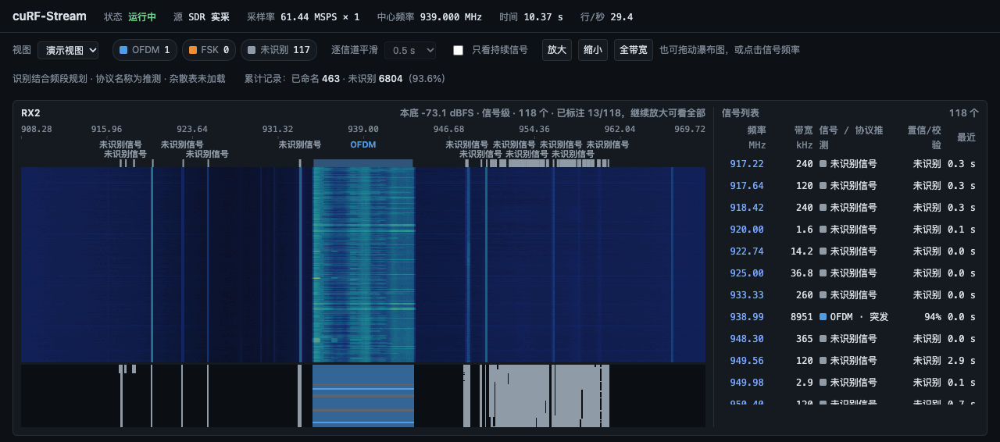
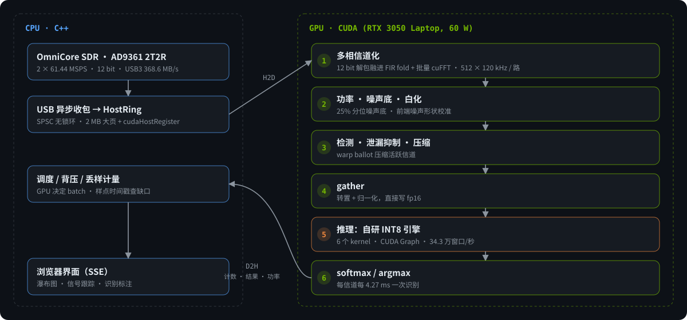
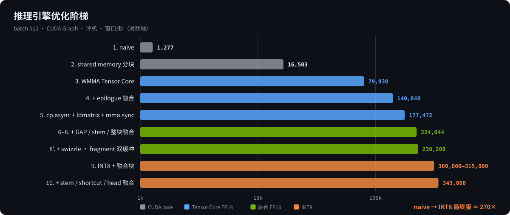
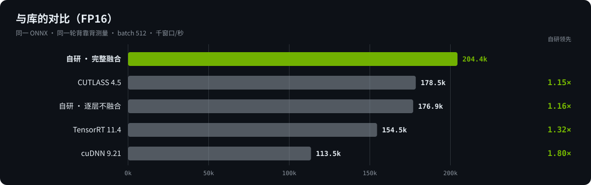

<p align="center">
  
</p>

<p align="center">
  <b>一块自研 USB3 SDR + 一台游戏本，实时处理双路 61.44 MSPS 宽带 IQ，显示频谱占用与信号识别结果。</b>
</p>

<p align="center">
  
  
  
  
</p>

<p align="center">
  <a href="#快速开始">快速开始</a> ·
  <a href="#重训版实时演示">实时演示</a> ·
  <a href="#硬件omnicore-sdr">硬件</a> ·
  <a href="#系统架构">架构</a> ·
  <a href="#自研推理引擎">推理引擎</a> ·
  <a href="#端到端结果">结果</a> ·
  <a href="#实采与回环">实采</a> ·
  <a href="#工程中的几个发现">发现</a> ·
  <a href="#局限">局限</a>
</p>

数据来自自研 USB3 SDR 及其传输层 OmniCore-SDR-Host。逐信道路径在 GPU 上完成解包、多相信道化和能量检测，再用**自研推理引擎**（手写 Tensor Core / INT8 kernel）完成识别。重训版演示从宽带 IQ 中提取候选信号窗口进行突发分类，并在浏览器里显示瀑布、频谱占用和识别结果。

下图来自逐信道识别路径的既有基准。测试硬件、负载、延迟和准确率见[端到端结果](#端到端结果)。

<p align="center">
  
</p>

<p align="center">
  <br>
  <sub>旧版实采界面（RX2，中心 939 MHz），展示瀑布、逐信道判决和信号列表。</sub>
</p>

| 逐信道基准 | 配置与结果 |
|---|---|
| 📡 输入 | 2 路 × 61.44 MSPS，12 bit，USB3（368.6 MB/s） |
| 🔀 信道化 | 512 信道 × 120 kHz / 路，2 倍过采样 |
| 🧠 识别 | 9 类调制 + 噪声，每信道每 4.27 ms 一次 |
| ⏱️ 实采长测 | **300 秒零丢样**，端到端延迟 p50 1.74 ms / p99 2.47 ms |
| ⚡ 推理引擎 | INT8 **34.3 万窗口/秒**；FP16 版对 TensorRT 11.4 领先 **1.3–1.4×** |
| 🔥 全负载（1024 信道全部识别） | 吞吐模式 1.31×；合成源 300 秒实时持平（受笔记本约 38 W 散热上限约束） |
| 💻 硬件 | RTX 3050 Laptop（4 GB，sm_86，60 W）、i5-11400H |

---

## 硬件：OmniCore SDR

本项目是 OmniCore SDR 的演示应用：插上板子，任何一台带 USB3 和 NVIDIA 显卡的电脑都能做全带宽的实时信号识别，不需要专用的 GPU 嵌入式平台或 RDMA 网卡。

| 项目 | 规格 |
|---|---|
| 射频 | AD9361，2T2R，70 MHz – 6 GHz，模拟带宽最高 56 MHz |
| 接口 | USB3（5 Gb/s），C ABI 驱动（OmniCore-SDR-Host） |
| 采样 | 2 路 61.44 MSPS（12 bit packed 或 8 bit）；12 bit 2R1T 时最高 58.5 MSPS |
| 时间 | 硬件时间戳，按样点计数，丢样可精确定位 |
| 可编程 | RX FIR 可在线加载（本项目用 64 tap ×2 抽取，阻带 −78 dB） |
| 传输层实测 | `och bench` 2 × 61.44 MSPS：368.8 MB/s，零丢样，零溢出 |

cuRF-Stream 只通过 OmniCore 的 C ABI 依赖它（`-DCURF_OMNICORE=ON`）。没有硬件也可以用合成源或录制文件跑通全部流程。

---

## 系统架构

下图为逐信道识别路径。`--burst` 演示对单路 packed12 IQ 做 FFT，以频谱功率定位候选信号，再提取 IQ 窗口交给同一推理引擎。

<p align="center">
  
</p>

数据源通过 `ISource` 接口可插拔：合成源（可超过 USB 速率，用来压测 GPU）、文件回放源（可复现）、OmniCore 实采源。

---

## 自研推理引擎

归档基准使用小型 ResNet-1D（13.6 万参数，每窗口 50.8 MFLOP，输入 `[B, 2, 1024]`）。引擎从 ONNX 开始全部自己实现：

- **离线转换器**（`model/convert.py`）：BN 折叠、conv + bias + 残差 + ReLU 融合、channels-last 布局、自定义二进制格式，同时导出逐层 golden 激活。
- **运行时**（`src/engine/`）：按张量生命周期做静态内存规划（arena 是不复用时的 1/2.5），热路径零 `cudaMalloc`；按 batch 档位分别捕获 CUDA Graph；每层多个 kernel 变体在线自动调优，结果可缓存。
- **kernel**（`src/kernels/`）：从 naive 到手写 PTX 的 `cp.async` + `ldmatrix` + `mma.sync` 隐式 GEMM，XOR swizzle 无 bank 冲突布局，fragment 寄存器双缓冲；整个 BasicBlock 融成一个 kernel；INT8 版复用同一套 tile 结构。
- **融合决策由实测决定**：每个 batch 档位、每个块，在整网里交替计时“融合 / 不融合 / 带 stem 融合 / 带 shortcut 融合”，取更快的方案。

### 优化阶梯

batch 512，CUDA Graph，冷机。每一级都有 Nsight Compute 数据支撑。

<p align="center">
  
</p>

<details>
<summary>完整数据表</summary>

| 步骤 | 窗口/秒 | 有效 TFLOPS | 关键改动 |
|---|---|---|---|
| 1. naive | 1,277 | 0.07 | 每线程一个输出 |
| 2. shared memory 分块 | 16,503 | 0.84 | fp32 FMA |
| 3. WMMA Tensor Core | 79,939 | 4.06 | epilogue 分离 |
| 4. + epilogue 融合、fp16 累加 | 140,848 | 7.15 | bias + 残差 + ReLU 在寄存器内完成 |
| 5. `cp.async` + `ldmatrix` + `mma.sync` | 177,472 | 9.01 | 多级流水、im2col 地址外提 |
| 6–8. + GAP / stem / 整块融合 | 224,044 | 11.4 | 激活流量 840 → 260 KB / 窗口 |
| 8'. + swizzle、fragment 双缓冲 | **230,200** | **11.7** | 每层都追平或超过 CUTLASS |
| 9. INT8 + 融合块 | 300,000–315,000 | — | 对称量化，99.99% 分位校准 |
| 10. + stem / shortcut / head 融合 | **343,000** | — | 每次推理 6 个 kernel |
</details>

从 naive 到 FP16 最终版约 **180×**；INT8 再快 1.5×。batch 1 延迟 30.1 µs。

### 和库的对比

同一 ONNX、同一轮背靠背测量（GPU 已温热，绝对值偏低）。cuDNN 和 CUTLASS 作为 kernel 变体接进同一个引擎，直接在引擎的 buffer 上运行，没有额外拷贝或重排。

<p align="center">
  
</p>

| 后端（FP16） | batch 512 窗口/秒 | 自研领先 | batch 1 | batch 8 |
|---|---|---|---|---|
| **自研，完整融合** | **204.4k** | — | 42.1 µs | 59.2 µs |
| CUTLASS 4.5 | 178.5k | 1.15× | 48.3 µs | 66.5 µs |
| 自研，逐层不融合 | 176.9k | 1.16× | — | — |
| TensorRT 11.4 | 154.5k | 1.32× | 42.0 µs | 81.8 µs |
| cuDNN 9.21 | 113.5k | 1.80× | 53.6 µs | 124.5 µs |

- **单层 GEMM**：与 CUTLASS 基本持平（不含 stem 的 10 层合计，自研快 3.8%）。
- **整体领先**：来自库做不到的部分，即整块融合、GAP 融合，以及按实测决定融合方案。
- **对 TensorRT**：多出的余量还来自头部（TensorRT 为 Myelin 子图做了两次 reformat）和省掉的输入重排。

---

## 端到端结果

本节记录 RTX 3050 Laptop 上的逐信道实测。重训版突发分类使用独立的模型与运行路径。

### 负载与 CPU 基线

全部 1024 个信道都识别时，需要每秒 24 万个窗口。

| | GPU（本项目） | CPU（i5-11400H，AVX-512） |
|---|---|---|
| 推理 | 34.3 万窗口/秒（INT8 引擎） | 3,339 窗口/秒（ONNX Runtime，12 线程） |
| 信道化 | 19.2× 实时（每块 0.111 ms） | PyTorch 0.07× 实时 |
| 能跟上的信道数 | 全部 1024（吞吐 1.31×） | 约 14 |

- **信道化**：12 bit 解包融进 FIR fold，不落地 fp32 中间结果，比 PyTorch 实现快 9.3×。
- **profile**：全负载时推理引擎占 GPU 时间的约 89%。

### 延迟

“端到端”从一个窗口的最后一块数据进入环形缓冲算起，到识别结果回到主机为止。窗口本身 4.27 ms 的积累时间由算法决定，不计入。

| 场景 | 丢样 | p50 / p99 / max |
|---|---|---|
| 合成源，每路 64 个活跃信道 | 0 | 0.95 / 1.05 / 1.15 ms |
| 合成源，全负载 30 秒 | 0 | 3.8 / 4.1 / 4.2 ms |
| **实采 300 秒，相对门限检测（平均 318 个活跃信道）** | **0** | **1.74 / 2.47 / 8.4 ms** |

### 准确率

准确率不是本项目的重点，模型保持小而够用。数字只用来说明整条链路没有损失精度。

| | 准确率 |
|---|---|
| 模型本身（合成数据，SNR −4 至 24 dB） | 89.5%（SNR ≥ 10 dB 时 94.7%） |
| 合成宽带场景走完整流水线，FP16 / INT8 | 92.9% / 92.7%（同信号直接送模型 92.9%），检测召回 100% |
| **实采 TX→RX 线缆回环，SNR 24 dB** | **91.4%** 单窗口；按 128 ms 投票 **96.3%** |

主要错误来自 16QAM 和 64QAM 互相混淆：1024 点窗口里只有约 43 个符号，不足以可靠区分高阶 QAM。

---

## 实采与回环

- **300 秒实采**：2 × 61.44 MSPS，驱动层和流水线均零丢样，没有出现不连续。主机队列峰值只有 0.9 MiB。
- **线缆回环**：TX1 发射 104 个已知调制的信号（9 类，在频域按整周期构造，循环发射无接缝），TX 衰减从 89.75 dB 逐级降到 50 dB，测量识别率随 SNR 的变化。软件把 TX 衰减锁在 ≥ 40 dB，低于这个值时拒绝打开设备，保护 RX 端。
- **空中实测**：记录了 900 MHz 下行信号、2.4 GHz Wi-Fi 突发和 FM 广播。实采仍会出现未识别信号和标签空窗。
- **前端噪声形状校准**：AD9361 的通带边缘有 5–9 dB 的噪声抬升，大小由增益决定。先在无信号时校准一次噪声形状，检测时按形状白化后用全局本底判断，误报减少一半到三分之二。
- **实时界面**：信道跟踪（指数衰减投票）、信号出现 / 消失的迟滞判断、相邻同类信道合并、区分突发和持续信号、拖动放大、信号列表。

---

## 工程中的几个发现

- **H2D 只有 PCIe 理论值的 45%**：根因是 IOMMU 的 IOTLB 缺失。`cudaHostAlloc` 按 4 KB 页映射，1 MB 就要 256 个表项。改用 2 MB 透明大页加 `cudaHostRegister` 后，H2D 从 7.0 提升到 12.4 GB/s（1.8×）。运行时还会从 `/proc/self/smaps` 检查大页覆盖率。
- **融合了反而更慢，ncu 每次都能定位原因**：常见的有三种，smem 超额导致 occupancy 下降、`cp.async.cg` 绕过 L1 后 k = 3 的重复读要回 L2、epilogue 写不合并。
- **融合与否不能靠单独计时来决定**：单独测时输入还留在 L2 里，而笔记本降频时 SM 时钟下降、显存时钟不变，两者都会让判断翻转。所以改为在整网里交替计时。
- **热态下的 autotune 不可靠**：GPU 热的时候调优，选出的 kernel 时好时坏（同样的负载跑出 0.89–1.09×）。应在冷机时调优一次并缓存结果（`--tune-cache`）。
- **有记录的负结果**：例如把 gather 并进 stem 融合块（访存跨度 4 KB，每个 sector 只用到 8 字节），以及在融合块上移植 swizzle 和双缓冲。都测过、写清原因后删除或保留为变体。
- **主机侧忙等也耗电**：`cudaEventSynchronize` 默认自旋，会占满一个 CPU 核；改用 blocking sync 后 CPU 占用从 90% 降到 30%。笔记本的 CPU 和 GPU 共用散热，CPU 少发热，GPU 就能维持更高的时钟。

**正确性**：每个 GPU kernel 都先有 CPU 参考实现或 golden 数据。解包、信道化线格式融合、fp16 输入等路径与参考逐位一致；推理的每个 kernel 变体都逐层对齐 golden。

---

## 快速开始

### 构建

CPU 部分（macOS / 任意平台，含参考实现、源、环形缓冲、模型加载等测试）：

```sh
cmake --preset cpu-debug
cmake --build --preset cpu-debug
ctest --preset cpu-debug
```

CUDA 部分（Linux，sm_86，CUDA 12.8）。预设默认启用 TensorRT 基线，有 TensorRT 时设置 `TENSORRT_ROOT`，仅用自研引擎时可关闭该选项。

```sh
cmake --preset cuda-release -DCURF_TENSORRT=OFF
cmake --build --preset cuda-release
ctest --preset cuda-release
```

可选组件：

| CMake 选项 | 作用 |
|---|---|
| `-DCURF_OMNICORE=ON -DCMAKE_PREFIX_PATH=<omnicore 安装目录>` | OmniCore 实采源（需要 libusb-1.0 开发包） |
| `-DCURF_TENSORRT=ON`，环境变量 `TENSORRT_ROOT` | TensorRT 基线 |
| `CURF_CUDNN` / `CURF_CUTLASS`（`CURF_CUTLASS_DIR` 指向头文件） | cuDNN / CUTLASS 基线，找到时自动启用 |

### 模型

模型文件在本地训练、导出和转换。下面生成逐信道路径默认使用的 `run1` 模型。实时演示使用 `demo` 模型，训练时加上 `--profile demo`，并把以下路径里的 `run1` 换成 `demo`。

```sh
pip install -r model/requirements.txt   # torch 需从 cu128 源安装，见文件内注释
python model/train.py   --out model/artifacts/run1 --steps 30000
python model/export.py  --ckpt model/artifacts/run1/best.pt --out model/artifacts/run1/export
python model/convert.py --onnx model/artifacts/run1/export/amc_fp32.onnx \
                        --ref  model/artifacts/run1/export/reference.npz \
                        --out  model/artifacts/run1/export
```

### run1 演示回放

单路 packed12 录音可通过 `--freq` 指定采集中心频率，界面按绝对频率显示。

```sh
build/cuda-release/bench/curf_classify --source file --file capture.p12 \
  --streams 1 --freq 5.77e9 --seconds 0 --int8 --ui-out capture.feed
python3 tools/ui_server.py --bind 127.0.0.1 --replay capture.feed --loop
```

2.4 GHz 演示优先显示有 Barker‑11 证据的 DSSS。DSSS 色带限在对应信道的占用子区段，其余宽带按相邻信道的 OFDM 票判决。
同一片占用的 Barker 标签过期后显示「占用」。5 GHz 演示依据与占用频带匹配的循环前缀。
物理层证据检测支持 40–65 MS/s 的输入。用「原始分类」查看逐信道模型的结果。

### 重训版实时演示

使用七类 demo 模型的导出目录。以下命令以 RX2 只收模式采集 30 秒，并同时保存瀑布和逐突发标签。

```sh
build/cuda-release/bench/curf_classify --burst --model model/artifacts/demo/export \
  --int8 --streams 1 --rx 2 --source omnicore --freq 2441e6 \
  --gain 18 --bandwidth 56e6 --band-mhz 50 --ring 128 --seconds 30 \
  --exclude-hz 2457600000 --ui-out rx2.feed
python3 tools/ui_server.py --bind 127.0.0.1 --replay rx2.feed --loop
```

5.8 GHz 可用 `--freq 5770e6 --gain 40 --band-mhz 44`。实时运行时，把采集命令放在
`tools/ui_server.py --bind 127.0.0.1 --` 后并省略 `--ui-out`。信号列表显示模型置信度或逐包证据。

### 基准与合成场景

```sh
# 合成源，每路 64 个活跃信道，按真实速率跑 10 秒
build/cuda-release/bench/curf_classify --int8 --tune-cache /tmp/i8.tune --active 64 --realtime --drop --seconds 10

# 全负载：1024 个信道全部识别
build/cuda-release/bench/curf_classify --int8 --tune-cache /tmp/i8.tune --detect all --seconds 30

# 带标注的宽带场景：生成 → 识别 → 打分
python tools/make_scenario.py --out /tmp/scn --windows 16 --spacing 4 --snr 5 20
build/cuda-release/bench/curf_classify --int8 --source file --file /tmp/scn/capture.raw --detect relative --dump /tmp/scn/results.csv
python tools/make_scenario.py --score /tmp/scn
```

前端噪声形状校准：天线断开（或输入端接负载）时，运行 `curf_classify --source omnicore --calibrate-noise <输出文件>`。换增益后需要重新校准。

### 基准

`bench/` 下每个程序都输出 JSON 行，便于复现和画图：

| 程序 | 测什么 |
|---|---|
| `curf_bench_unpack` / `curf_bench_pcie` | 解包 kernel 带宽；H2D / D2H 与大页的关系 |
| `curf_pipeline` | P1 流水线吞吐、stream 重叠、延迟 |
| `curf_bench_channelizer` | 多相信道化 |
| `curf_bench_engine` | 引擎优化阶梯、逐层耗时（`--ops`）、ncu 采集（`--profile`）、库基线 |
| `curf_classify` | 端到端：吞吐、延迟分位、丢样、准确率 |

辅助脚本：`tools/ncu_summary.py`（ncu 报告逐 kernel 汇总）、`tools/nsys_overlap.py`（拷贝与计算的重叠率）、`tools/cpu_baseline.py`、`tools/loopback.py`。

---

## 代码结构

```
include/curf/         公共头文件（格式、ISource、参考实现、CUDA / 引擎 / 运行时接口）
src/
  source/             合成源、文件回放源、OmniCore 实采源
  runtime/            HostRing、生产者、P1 流水线、端到端 classifier
  kernels/            解包、PSD、信道化、检测与 gather、conv（naive / WMMA / mma / INT8）、
                      融合块（FP16 / INT8）、cuDNN 与 CUTLASS 基线
  engine/             模型加载、内存规划、融合决策、自动调优、CUDA Graph
  reference/          CPU 参考实现
model/                合成器、ResNet-1D、训练 / 导出 / 转换
bench/                基准程序与 curf_classify
tests/                Catch2 测试（GPU 对 CPU 参考 / golden）
tools/                界面、场景生成、回环、FIR 设计、噪声形状、profile 汇总
```

---

## 局限

- 合成训练数据与真实空中信号有域差异。直流残余和硬件杂散可能触发误报，弱信号也可能出现标签空窗。
- **单个 240 kHz 信道里，宽带类噪声和 OFDM 本来就难以区分**，所以空中实测里 OFDM 的命中只能算定性一致。
- **全负载在实采时扛不住**：持续 1024 信道识别时，实采只有 0.97×（丢样 3%）。CPU 处理 368 MB/s USB 数据产生的热量会压低 GPU 时钟。要留出余量，需要减少计算（时间复用、模型瘦身），或者走零拷贝 USB → 锁页内存这条路。
- **只在一台机器上测过**（RTX 3050 Laptop，散热上限约 38–45 W）。
